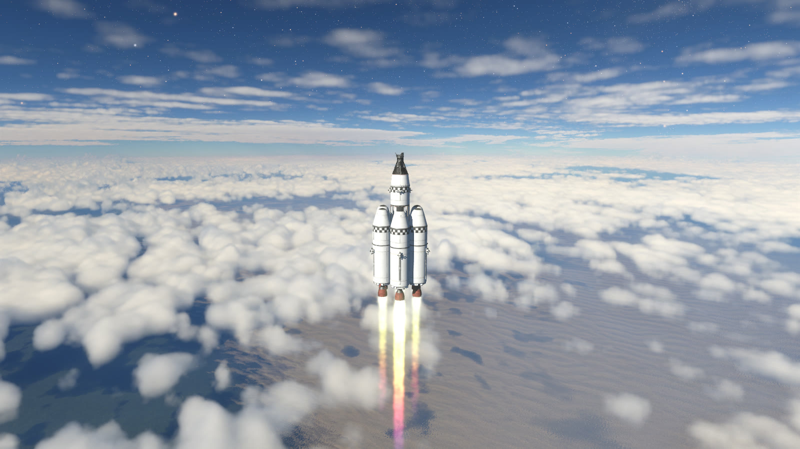
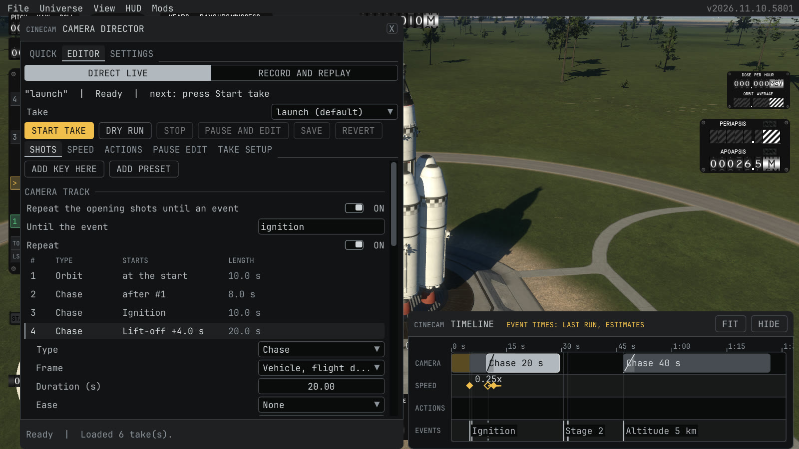
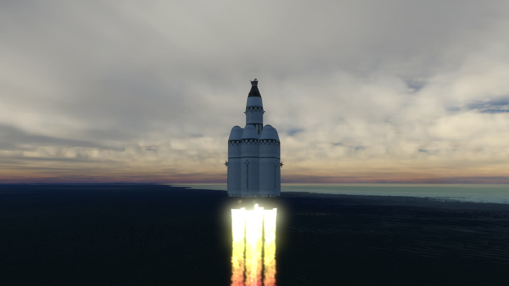

# CineCam [](https://opensource.org/licenses/MIT)

A camera mod for [Kitten Space Agency](https://ahwoo.com/app/100000/kitten-space-agency). Pick a camera with one click, or build a take with a timeline and film your flight.



Requirements:

- [StarMap](https://github.com/StarMapLoader/StarMap) 0.5.3 or later
- KSA build 2026.11.25.5949. The mod is tested against this build only.

## Features

- **Quick cameras.** Flyby, Chase, Orbit, Onboard and Ground tracker. One click, no setup, on the pad, in the air and in orbit.
- **Takes with a timeline.** A take is a list of shots. Fly the free camera to a good place and press Add key here, or add a shot from a preset. No numbers to type.
- **Events.** Start a shot on lift-off, staging, docking, dynamic pressure, max Q, loss of control, EVA, explosions, orbital events, or a height over the ground before landing.
- **Slow motion and speed keys.** A button sets the sim speed, and a take can change the sim speed on a timeline.
- **Flight recording and replay (experimental).** Record a flight and edit the shots afterward. Replay includes crew, EVA kittens, parachutes, fireballs, engine sounds and the lighting of the recorded time.
- **Render to pictures.** Save numbered PNGs from a live take or replay. Choose the screen with overlays or a clean scene. Save a still at up to eight times the window size.
- **Take sound and look.** Save the game mix of a real-time take to WAV. Set its music and effects levels, exposure, and selected graphics options for the duration of the take.
- **Overlay cues.** Let a companion mod show an overlay at lift-off or another point in the take, including during replay and screen renders.
- **Language.** Choose English or German in Settings, or follow your system language.
- **Event log.** Each run writes the time of every event, with a tool that turns it into markers for a video editor.



## Installation

1. Install [StarMap](https://github.com/StarMapLoader/StarMap) 0.5.3 or later.
2. Extract the mod into `Documents\My Games\Kitten Space Agency\mods\CineCam\`.
3. The game finds new mods and asks to enable them. You can also add this to `Documents\My Games\Kitten Space Agency\manifest.toml`:

```toml
[[mods]]
id = "CineCam"
enabled = true
```

## Quick start

1. Load a flight and select a vehicle. The mod does not work in the vehicle editor.
2. Open the window with the **CineCam** item of the **Mods** menu, or press **Insert**.
3. On the **Quick** page, click a camera. Click **Stop** to give the camera back.
4. To make a take, open the **Editor** page and press **New take**. Fly the free camera to a good place, press **Add key here** and pick a shot type. Press **Save**.
5. Press **Start take** (or **Pause** on the keyboard) to run it. Press the key again to stop it.
6. To direct a flight afterward, turn on **Replay of recorded flights** under **Experimental** in Settings. On the Editor page choose **Record and replay**, press **Record flight**, fly, press **Stop recording**, select the recording and press **Open replay**.



## Documentation

- [Player guide](docs/guide.md): the quick cameras, directing a take, recording and capture, settings and keys.
- [Flight replay and render](docs/replay.md): record a flight, play a take on it, render it to pictures, and what is recorded.
- [Shot file reference](docs/shot-file.md): the shot file format, the events, the take folder and the event log.
- [Integration for other mods](docs/integration.md): subscribe to take, replay, render and cue events.
- [Localization](docs/localization.md): language preferences and translation maintenance.
- [Development](docs/development.md): building, tests, console commands, local control, and the checks for a game update.

## Known limits

- The flight replay is experimental. It draws the recorded vehicles through patches of the game renderer, so a game update can break it. It is off until you turn it on.
- Engine and thruster sounds are optional in a replay. Leave the replay muted for silent playback, or turn off **Mute the game during a replay** to hear them. Use **Record the game sound of a take** for the full mix in a WAV file.
- Parachutes use the recorded deploy state and target shape. Cloth flutter, dents, plume trails, smoke and particles are outside the recording.
- A replay needs the same star system and the recorded parts. You can confirm an older game build recording after reading the warning. Part changes can affect how it looks.
- A recording holds 20 minutes of game time at 1x speed and follows the controlled vehicle and a limited number of other vehicles.
- The mod is tested against KSA build 2026.11.25.5949 only. It patches game methods that are not a public modding interface, so a game update can break a feature until the mod is updated. It writes a warning in the log on another build.
- The import of the marker file into DaVinci Resolve has not been tested.

## How this mod was made

I directed AI tools to write the code, tests and documentation, and I tested the mod in the game. I do not know the codebase in detail. It has worked really well for me so far and I find it useful, so I am publishing it.

If you find a problem, please open an issue here or message me on the KSA Discord (Maxi).

## License

MIT. See [LICENSE](LICENSE).
