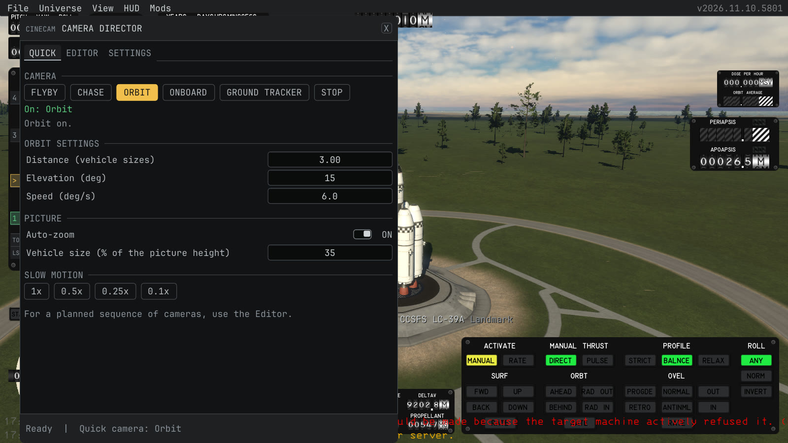
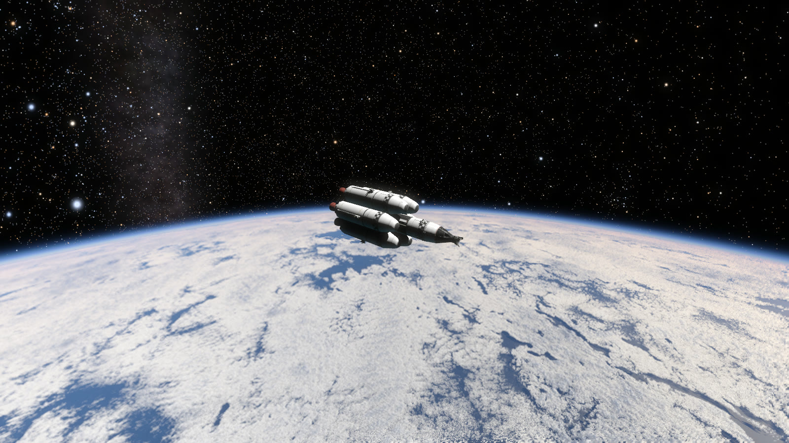
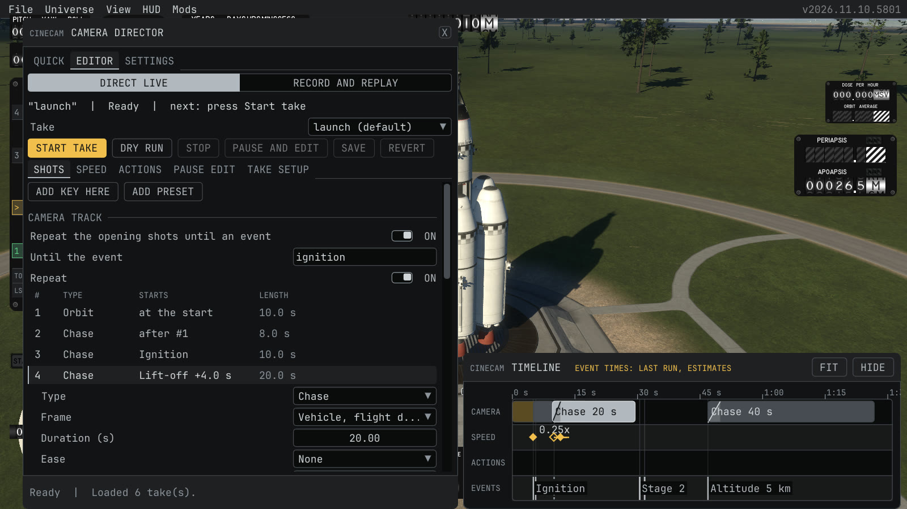

# CineCam player guide

This page tells how to use the quick cameras, direct a take, record and capture, and set the keys. Back to the [README](../README.md).

## Quick cameras

1. Load a flight and select a vehicle. The mod needs a controlled vehicle near a planet or a moon. It does not work in the vehicle editor.
2. Open the window with the **CineCam** item of the **Mods** menu, or press the window key (**Insert** by default).
3. Stay on the **Quick** page and click a camera:

| Camera | What it does |
| --- | --- |
| **Flyby** | A fixed camera ahead of the vehicle. The vehicle flies past and the camera turns to follow it. **Next flyby** places a new point ahead of the vehicle. |
| **Chase** | Behind and above the vehicle along its direction of flight, with a level horizon. |
| **Orbit** | Circles the vehicle with a level horizon. |
| **Onboard** | A camera on a part of the vehicle that looks along the stack. **Previous part** and **Next part** pick the part. |
| **Ground tracker** | A long lens on the ground near the point under the vehicle. It follows the vehicle like a launch tracking camera. It works up to a limited range, and the page shows the range. |

4. Change the settings of the camera below the buttons. Distances are in vehicle sizes, so the same value suits a small and a large vehicle. Under **Picture**, **Auto-zoom** keeps the vehicle at the same size in the picture, or you set the field of view yourself.
5. Under **Slow motion**, click 1x, 0.5x, 0.25x or 0.1x. The speed from before comes back when the quick camera stops.
6. Click **Stop** to give back the camera, the field of view and the sim speed. A take, a shot preview or a replay also stops the quick camera.

For a planned sequence of cameras, use the **Editor** page.





## Direct a take

A take is a shot list: the cameras of a flight, with the game speed and the stage actions. It is for a shot that you want to repeat, to time to the flight, or to record. Open the **Editor** page. With the replay turned on, a switch at the top chooses where the take runs: **Direct live** (the default) or **Record and replay**.



### Make a take

1. Press **New take**, or pick **New take** at the end of the **Take** list when the file has a take already. The mod adds a take with one chase shot that suits any vehicle.
2. Fly the free camera to a good place. The shot needs a controlled vehicle in flight.
3. Press **Add key here** and pick what the camera does:
   - **Fixed**: stays at this place and looks in this direction.
   - **Track**: stays at this place and turns to follow the vehicle.
   - **Chase**: keeps this offset from the vehicle and follows it, with a level horizon.
   - **Orbit**: turns around the vehicle, starting from this place.
   - **Part mount**: is fixed to the vehicle at this place, like an onboard camera.
   - **Path point**: adds this place as a point of the selected path shot, or starts a new path shot here.
4. Or press **Add preset**. A preset is a shot that the mod sizes for your vehicle: **Tower cam**, **Ground tracker, long lens**, **Chase, low**, **Onboard, down the stack**, **Orbit reveal** and **Flyby**. The presets that stand at a fixed place use the place of the vehicle now, so they suit a shot that starts soon.
5. The new shot goes in after the selected shot. Press **Save** to keep the take. The old file stays as a `.bak` copy.

Above the take, one status line says the take, its state (**Ready**, **Running 12.0 s**, **Paused at 12.0 s** and so on) and the next thing to do. Its tooltip has the game speed, the vehicle and the checkpoint. Below it are the **Take** list and one row with **Start take**, **Dry run**, **Stop**, **Pause and edit**, **Save** and **Revert**; in a narrow window the run buttons use the short labels **Start** and **Pause**. A problem of the take shows as one line in plain words, for example "Shot 4: the length must be above 0 s and at most 3600 s." Click it to select that shot, speed key or action; its tooltip has the exact text of the file reader. The footer of the window shows the two most important states, and its tooltip lists all of them.

The Editor page has the tabs **Shots**, **Speed**, **Actions**, **Pause edit** and **Take setup**. A click on a row in **Shots** opens the fields of the shot below it, and a second click closes them. Most shots need no more than Add key here. Use the fields for fine work: the length, the field of view, the roll, a blend to the next shot, **Fit the vehicle** (keeps the vehicle at a share of the picture height) and **Keep away from the sun**. **Preview shot** plays the selected shot on your vehicle without a change of the sim speed.

### Frames

A shot places its camera in a frame. The **Frame** field of a shot lists the choices that the shot type allows. Add key here picks a fitting frame for you. All lengths are in meters.

| Frame | The camera is placed relative to | Axes |
| --- | --- | --- |
| **World point** | A point on the ground that does not move. | +X up, +Y east, +Z north |
| **Vehicle** | The vehicle. The camera moves and turns with it. | +X to the nose, +Y right, +Z down |
| **Vehicle, horizon level** | The vehicle, but the horizon stays level when the vehicle turns. | +X away from the ground, +Y east, +Z north |
| **Vehicle, along flight** | The vehicle, turned with its direction of flight. A camera at +Z looks back along the path of the vehicle. | +X away from the ground, +Z along the flight |
| **Part** | A part of the vehicle (for a Part mount shot). Like Vehicle, with the origin at the part. | As Vehicle |

A take does not need a launch site. The mod picks the origin of the world point in this order:

1. The Landmark that the take or the file names (developer setting).
2. The anchor of the take. The first key that you make in a take without a Landmark stores the ground point under the vehicle as the anchor, so the next runs use the same place.
3. The Landmark nearest to the vehicle, within 2000 m.
4. The ground under the vehicle at that moment.

So a take works on the pad, in the air, at a landing and in orbit. A world point shot in orbit works, but the camera is then far from the vehicle, so use a vehicle frame there. If a named Landmark or an anchor cannot be found, the take does not start.

### The timeline dock

The timeline sits at the bottom of the screen while the window shows the **Editor** page and a take is selected, and always while a replay is open (see [Flight replay](replay.md#flight-replay-experimental)). Until you first click an item of the dock, the free part of the Camera row says how to use it. It has four rows: **Camera**, **Speed**, **Actions** and **Events**. The Events row is read only.

- **Click** a shot, a speed key or an action to select it. The window shows its fields.
- **Drag** the right edge of a shot to change its length. Drag a speed key or an action to move it. Only an item that starts at a time can move. An item that starts on an event has its time from the event.
- **Right click** a shot for **Duplicate**, **Delete**, **Cut** and **Blend**. A speed key or an action has **Duplicate** and **Delete**. These two wait until no take runs.
- **Mouse wheel** zooms. **Shift and the wheel**, or a drag on the ruler, scrolls. In a replay a drag on the ruler moves the replay instead.
- **Fit** shows the whole take. **Hide** hides the dock, and the **Timeline** button at the bottom shows it again.

A blend shows as a ramp at the start of a shot, and the play head shows the take time while a take runs. The times of the events come from the run that is going on, or from the last finished run of the take. An event that no run has seen yet has an estimated time. The mod spaces such items evenly and draws them hatched or dashed, so run the take once to measure the events. In a replay every event time comes from the recording, so nothing is estimated.

### Start on an event

A shot, a speed key or an action starts **After** the one before, at a **Time** of the take, or on an **Event**. For an event, pick a name from **Pick event** and set a **Delay** in seconds after it. The window shows the events by plain names:

| Plain name | When it happens |
| --- | --- |
| **Ignition**, **Ignition 2** | The engines come on. The second ignition is, for example, the upper stage in a hot staging. |
| **Lift-off** | The vehicle has no ground contact any more. |
| **Burnout**, **Burnout 2** | All engines turn off after they ran. |
| **Stage 3** | Sequence 3 of the vehicle fired. |
| **Altitude 5 km** | The altitude reaches a value. Type `altitude:5000` in the event field. |
| **Speed 300 m/s** | The speed over the surface reaches a value. Type `speed:300`. |
| **Landed** | The vehicle touches the ground again after a lift-off. |
| **SOI change** | The vehicle enters the sphere of influence of another body. |
| **Apoapsis**, **Periapsis** | The vehicle passes the highest or lowest point of its orbit. |
| **Docked**, **Undocked** | A docking port connects or disconnects. The take follows the vehicle that the game gives the control to. |
| **Mark** | You pressed the mark key during the take, or during a flight recording. |

A negative delay works only for altitude and speed events, which the mod can predict. The **Take setup** tab shows the events that the mod sees on your vehicle live, so you can check them on the pad.

### Run a take

1. Press **Start take**, or the start key (**Pause** by default). The take runs until its last shot ends. Press the key again, or **Stop**, to end it.
2. **Dry run** moves only the camera. It leaves the sim speed alone and writes nothing.
3. While a take records, the window is hidden so it is not in the video. Turn on **Keep this window open during a take** in Settings to keep it.
4. When the take ends, the camera mode, the field of view and the sim speed come back. If you change the camera mode yourself during a take, the take ends and leaves your mode alone.

The **Speed** tab has speed keys: each key ramps the sim speed to a target, for example 0.25x at the ignition and 1x after the lift-off. The game locks the throttle above 30x, so stay below that. The **Actions** tab can press the staging key at a time or an event, for example to release a fairing. This sends a real staging key, so use it with care.

### Pause and edit

Press the edit key (**End** by default) or **Pause and edit** while a take runs. The sim and the take clock stop, the camera is free, and the window opens with the **Pause edit** tab. A shot preview and an offline capture cannot be paused. The tab shows the current shot and these buttons:

| Button | Action |
| --- | --- |
| **Apply camera to this shot** | Writes the pose of the free camera into the shot, in the frame of the shot, together with the field of view. |
| **Add path point here** | Adds the camera as a point of the current path shot. On a fixed or chase shot it turns the shot into a path shot. |
| **Add key here**, **Add preset** | Add a new shot that starts at this moment. It goes into the list after the shot that shows at this moment (never into a pre-roll loop), and it gets the time until the next shot starts when that shot starts after the one before it, so the later shots keep their times. It goes into the file of the window only. |
| **This shot starts here** | Sets the start of the shot to the latest event seen plus the seconds since it. |
| **Add speed key here**, **Move key N here** | Adds a speed key at this moment, or moves the selected key here. |
| **Stage here** | Adds a stage action for the next sequence of the vehicle at this moment. |
| **Resume** | Gives the camera back to the shot and the sim speed back to the earlier value. |
| **Stop take**, **Save file** | End the take, or write the file. |

A pose change goes into the running take and into the file. A start time, a speed key or a new shot goes into the file only, because the timeline of a running take is fixed when it starts. The window opens by itself when a take is paused. If you close it during the pause, it stays closed until the next pause, and the edit key still resumes the take.

### Checkpoint and reset

A checkpoint is a game save that lets you fly the same take again and again from the same state. On the **Take setup** tab:

1. Stand at the start of the flight and press **Save checkpoint**. The mod saves the game as `CineCam <take name>` and stores the name in the take. A second save replaces the first.
2. Fly the take. For another run, press **Reset to checkpoint**, or the reset key (off by default). The reset ends a running take, loads the save and makes the take ready.
3. With **Start the take after a reset** on, the take starts by itself after a **Delay** (2 s by default). Without it, press **Start take**.

Other mods lose their state when the game loads a save. Arm them again after a reset. A good loop: fly the take, pause where a shot needs a change, edit, resume, and reset for the next run.

### Hide the interface, sync flash

On the **Settings** page, **Hide the game interface during a take** hides the game interface while the take records. **Hide at (event)** hides it later, for example at the ignition, so you can still work with the interface until then. A pause for an edit shows it again. **White frame at the take start** draws one white frame at the start, as a mark for the cut in the video.

## Record and capture

**Real time.** Record the screen yourself, for example with OBS. Turn on hiding of the interface for a clean picture and the white frame to mark the start in the video.

**Offline.** On the **Settings** page, under **Video**, set **Capture mode** to offline and set **Pictures per second**. The game then steps by one over this value for each picture and saves one numbered picture per frame, so the video has the exact speed at any render speed. The game may run slower than real time and makes no sound. The pictures have the size of the game window. A start from this window uses the mode, and a dry run and a preview never save pictures. The pictures are in the folder `frames` of the output folder (the folder of the take when you leave **Output folder** empty) as `000001.png`, `000002.png` and so on. The folder also holds `make-video.cmd` and `make-video.sh`. With ffmpeg on the path, run one of them, or:

```
ffmpeg -framerate 30 -start_number 1 -i frames\%06d.png -c:v libx264 -pix_fmt yuv420p -crf 16 video.mp4
```

Add the music in the video editor. A picture that the game does not save is made again with a very small time step, and the take ends when three pictures in a row fail. A take needs free disk space for all pictures. Each run also writes an event log, see [the take folder and event log](shot-file.md#take-folder-and-event-log).

## Settings and keys

Open the **Settings** page of the window. A key change is saved at once. A key that another action uses is taken from it. The keys work while the game interface is hidden. The list has only keys with no default binding in the game: `Pause`, `ScrollLock`, `Insert`, `Home`, `End`, `KpDecimal`, `KpDivide`, `KpMultiply` and `KpEnter`. A key that the game also uses, set in the file by hand, does both actions.

| Setting | Default | Action |
| --- | --- | --- |
| Open or close this window (`windowKey`) | Insert | Opens and closes the CineCam window. In a replay with the interface hidden it shows the interface again |
| Start or stop the take (`startStopKey`) | Pause | Starts the default take, or stops the running one. In a replay it closes the replay |
| Pause the take for an edit (`editKey`) | End | Pauses the running take for an edit, or resumes it |
| Reset to the checkpoint (`resetKey`) | off | Loads the checkpoint of the default take. Use a key that you do not press by chance |
| Mark a moment (`markKey`) | off | Gives a mark event in the running take or flight recording: `mark`, `mark:2` and so on |
| Play or pause a replay (`playPauseKey`) | Home | Plays and pauses an open replay. Space cannot do this, because the game moves the free camera up with it |
| Check the shot file (`reloadKey`) | ScrollLock | Developer mode only. Checks the shot file and logs the result |
| Keep this window open during a take (`showWindowDuringTake`) | off | Keeps the window on the screen while a take records |
| Replay of recorded flights (`experimentalReplay`) | off | Shows the replay |
| Record the flight with each take (`recordWithTake`) | off | Records the flight while a take runs, for a replay. Needs the replay |
| Developer mode (`developerMode`) | off | Shows file paths, the file section of the take, the local control and the autotest |
| `enableLocalControl` | off | Settings file only. See [Local control](development.md#local-control-from-a-terminal-developer-mode) |

The page has the groups **Video**, **Interface during a take**, **Keys**, **Free camera**, **Game speed**, **Time of day**, **Experimental** and **Developer**. A label that does not fit beside its control stands on its own line above it. Other items of the page:

- **Free camera FOV**: changes the field of view of the game camera now. It goes back when the window closes.
- **Game speed now**: a slider and the buttons 0.1x to 4x. It is locked while a recording take runs, while an automatic warp runs and while a menu pauses the game.
- **Time of day**: **Move game time** moves the game time forward to the next time that the sun at the launch site has the **Sun elevation**. Turn on **Sun going down** for the evening. The game time cannot go back.
- **Interface during a take** and **Video**: see above. **Frames per second** is the frame rate of the video that the take is cut for. **Capture mode**, **Pictures per second** and **Output folder** are the capture settings. **Event names of the file** gives your own name to an event, for example `fairing` for `sequence:3`.

The settings are in `Documents\My Games\Kitten Space Agency\CineCam\settings.json`. The mod writes the file with its defaults at the first start and again when you change a setting. Use a key name of the GLFW key list, or an empty text to turn a key off. If the file cannot be read, the default keys are used, the Settings page shows the error with **Read the settings file again**, and changes are not saved until the file is correct, so your file is never replaced with the defaults.
