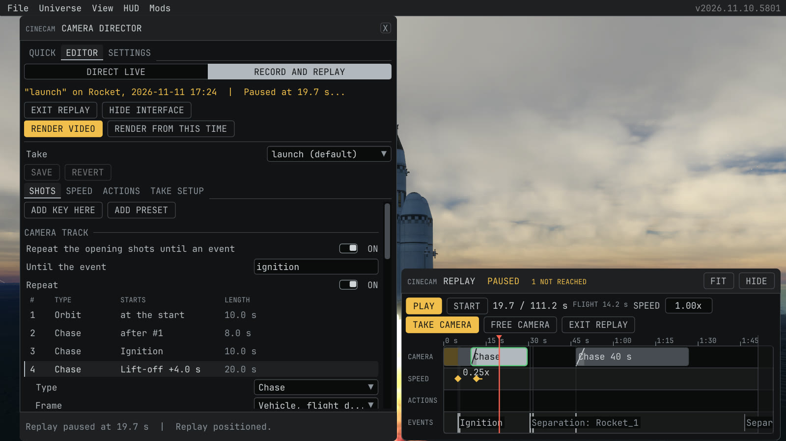
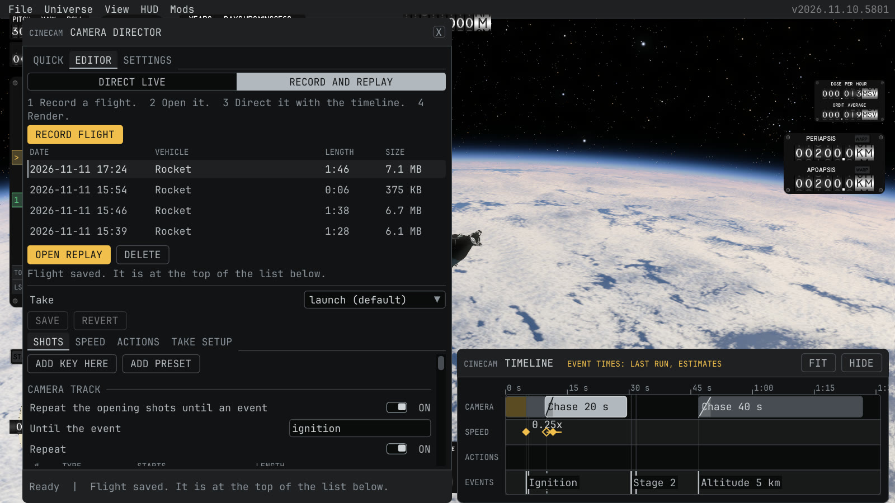
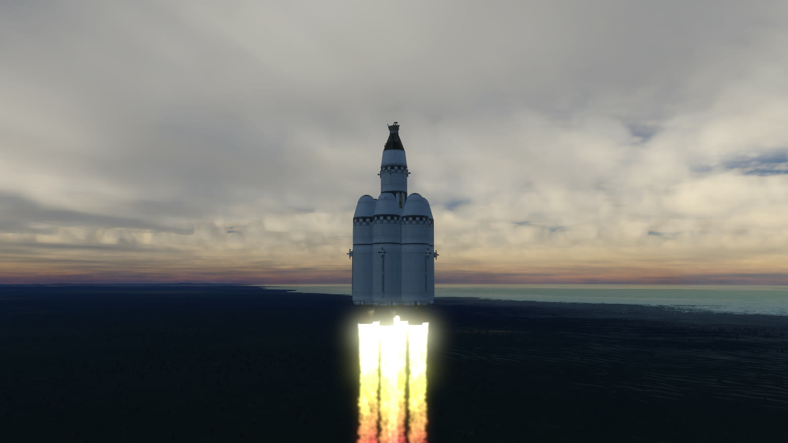

# Flight recording, replay and render

This page tells how to record a flight, play a take on it, render it to pictures, and what the replay stores. Back to the [README](../README.md).

## Flight replay (experimental)

The replay records a flight and plays a take of the editor on it, with the same shots, frames, events and speed track as a live take. So you can fly once and direct the cameras afterward. It draws the recorded vehicles through patches of the game renderer, so a game update can break it. It is off until you turn it on.





1. Open **Settings**. Under **Experimental**, turn on **Replay of recorded flights**.
2. On the **Editor** page, choose **Record and replay**. The switch only chooses where the take runs: the page shows the same take editor as **Direct live** (the take bar and the tabs **Shots**, **Speed**, **Actions** and **Take setup**), with the replay controls in a block above it. The block names the steps: 1 Record a flight. 2 Open it. 3 Direct it with the timeline. 4 Render.
3. In flight, press **Record flight** in that block. Fly as usual. CineCam records the controlled vehicle, the stages that split from it, the vehicles within 2 km of it (for example a docking target or a station), the seated crew, kittens on EVA within 2 km, and flight events (ignition, lift-off, stages, burnout, landing, docking, max Q, control, EVA, explosions, your marks and the others), each with the detail of the take log. When the game gives the control to a vehicle with parts of the recorded one, at an undocking, a docking or a breakup, the recording follows that vehicle, as a live take does. The mark key and `cinecam_mark` give a mark event in the recording too. A live take, a dry run, a shot preview and a quick camera can run while the flight records, so you can direct the flight live and keep the recording to cut it again later. Turn on **Record the flight with each take** in Settings to start a recording with each take (not with a dry run) and save it when the take ends; the name of the recording then has the name of the take. A recording that you started yourself goes on after the take. While the window is closed, a strip at the top of the screen shows the recording with **Open CineCam**, **Stop recording** and **Hide**.
4. Press **Stop recording**. The list of recordings shows the date, the vehicle, the game build (its last number, for example `5901`), the length and the file size of each recording, the newest first. The tooltip of a row names the whole build, the star system and the body. Select one and press **Open replay**. **Delete** removes the selected recording: press **Confirm delete** to delete the file, or **Cancel**. The live flight pauses while the replay is open. Close the game menu before you open a replay. The keys for the next and previous vessel or body do nothing while the replay is open, and the vehicle you controlled is in control again when you exit.
5. The replay plays the take that is selected in the editor. The times of the recorded events are known before the replay plays, so a shot that waits for an event starts where it would start in a live take on the same flight, on the same frame grid of 1/60 s. The events come from the samples of the recording (30 per second of game time, one per frame in time warp), so an event can be up to one sample later than in the live flight. Altitude, speed, ground, slow and dynamic pressure (`q`) events are found between two samples. A max Q has the time of its peak in the replay, where a live take finds it a few seconds later; a recording made before CineCam knew max Q gets it from its samples. The events of the flight state (control, probe cores, power, life support, crew, EVA, boarding, explosions, gimbal limit and mission arrival) come only from the recording, so a recording made before CineCam knew them does not have them. A recording ends when the vehicle enters another sphere of influence, after a final sample that includes the SOI and mission arrival events. A recording stores the height of the vehicle over the ground; for a recording made before it did, the replay computes the height from the recorded pose, the parts and the terrain, with the same math as the live take, but with the parts as they were when the part count last changed, so a landing leg that deployed later does not count. A recording from CineCam 0.1 and a vehicle change before this version have the limits below. The speed track of the take sets the speed of the flight, as it sets the sim speed in a live take. Stage actions do nothing in a replay, because the flight is recorded. Cues fire when playback passes their time. See [Integration for other mods](integration.md).
6. The timeline dock at the bottom of the screen is the replay control, also while the window is closed. Its title says **Replay**, the vehicle and date of the recording, whether it plays and, during a render, the progress. When the title has no room, the name of the recording is left out first. Below the title are **Play** or **Pause**, **Start**, the take time and the length of the replay (the time of the video), the time of the flight, **Speed** (watch the take slower or faster; the speed track still applies on top), **Take camera** and **Free camera**, and **Exit replay**. Click or drag on the ruler to move the replay in either direction; a drag shows the take with a short warm-up of the camera smoothing, and the release of the mouse, or a stop of the mouse for a quarter second, shows the exact picture. Click an event or a separation on the Events row to move there. The tracks show the take at the exact event times of the recording. A shot, speed key or action that waits for an event that the recording does not have never starts; the title of the dock counts them as **not reached**, and its tooltip names them. A take that cannot play as it is says why below the controls and in the footer of the window. The play and pause key (**Home** by default) plays and pauses the replay.
7. **Take camera** shows the take, in the fixed camera mode of the game as in a live take, so the keys, the gamepad and the mouse do not move it. **Free camera** lets you look around with the normal KSA free camera controls; in the replay block of the window choose the vehicle that the free camera moves with and its field of view.
8. Edit the take in the window or in the dock while the replay plays. Every change shows in the replay after a moment: the take is planned again in the background, and the replay plays the last plan until the new one is ready. **Add key here** and **Add preset** make a normal shot that starts at the replay time, from the view of the camera, in the place of the list that this time gives, as in a pause of a live take, and **Set from camera** writes the view into the selected shot. When an edit makes the take impossible to play, the replay plays the take as it was before the edit and names the problem in the same plain words as the problem list of the editor, for example "Shot 4: the length must be above 0 s and at most 3600 s." **Take setup** lists the events and the separations of the recording; click one to move the replay there. Save the editor to keep the changes. In a replay the take bar has no run buttons, because play, pause and the move to the start are in the dock.
9. **Hide interface** hides the game interface for a screen recording; its tooltip names the keys of the replay. Press the window key (**Insert** by default) to show it again; without a window key the interface cannot be hidden. **Exit replay**, or the start and stop key (**Pause** by default), returns to the live flight. The replay keys do nothing while a text field has the keyboard, and the start and stop key and the play and pause key do nothing while a game menu is open. When the window covers the bottom of the screen so that the dock has no room, **Close window, show timeline** in the replay block closes the window. The stock alert "Simulation paused" does not show over the replay view, because the replay always holds the game at speed 0; it comes back when the replay closes.



Replay files are saved under `Documents\My Games\Kitten Space Agency\CineCam\replays\`. Open a recording in the same star system, with its parts installed.

### Recordings of an older game build

A recording stores the game build that made it. The replay block shows the build of the open recording and the build of the game.

- A recording of the same build opens with **Open replay**.
- A recording of an older build shows **Open older recording**. Press it, read the warning, and press **Confirm open**, or **Cancel**. The local control opens it with `open --older-build`.
- A recording of a later build, or of a build whose order is not known, does not open. Update the game first.

The replay builds the recorded vehicles from the parts of the running build, so an older recording can look different from the flight:

- A part that is missing in this build stops the open, and the message names the part.
- A part whose look changed shows its new look.
- The part state (panels, legs, doors, gimbals, heat, wetness and lights) is stored in the order of the part modules. When a part of a vehicle segment has other modules in this build, that segment shows its parts without the recorded state, as the part tree stores them at the start of the segment.
- When the engines of a segment differ from the recorded engines, that segment shows no engine plumes.
- A connection to a part connector that the part no longer has is dropped, as the game drops it when it loads a saved vehicle.
- The terrain, the scenery and the star system are those of the running build.

The replay block and the game log name what the replay left out. The movement, the events and the take are the same as on the build of the recording.

Limits:

- A recording follows the controlled vehicle and up to 15 other vehicles around one body: the vehicles that split from it, and up to 4 vehicles that come within 2 km of it (checked once per second). After an undocking, a docking or a breakup it follows the vehicle that the game gives the control to, when that vehicle has parts of the one before. When the followed vehicle docks to another vehicle and the game removes it, the recording follows the vehicle that has its parts now, also when the control stays elsewhere; the separated vehicles of the shots then count from that moment, as in a live take. A switch to an unrelated vehicle does not change the recording. A nearby vehicle is recorded only while 8 vehicle slots stay free for stages, and it is not a separated vehicle for the shots.
- Debris never ends a recording. The pieces of the followed vehicle get any free vehicle slot but the last, which stays for a change of the followed vehicle, and the larger pieces come first. A vehicle that splits from another recorded vehicle (a dropped stage or a nearby vehicle) is recorded only when it has at least 2 parts, at most 2 such pieces per vehicle, and only while 5 slots stay free for the followed vehicle and its stages. A vehicle that gets no slot is not recorded, and the status and the log say so once.
- It samples every vehicle 30 times per second of game time and plays back smoothly between the samples.
- A recording holds 20 minutes of game time at 1x speed. Time warp records one sample per frame, so a warped flight can cover more game time.
- The recording ends with a message, and keeps what it recorded, when it reaches this length or its file size limit, when the followed vehicle changes to a vehicle that has no free slot, when the followed vehicle is lost or leaves the body and no vehicle has its parts, or when the game changes scene. Another vehicle that is lost (for example after a docking or a crash) or leaves the body stops at that time, and the recording goes on.
- The replay stores movement, vehicle topology, engine exhaust state, the flight events and the vehicle state that the events need (engine, ground contact, stage, altitude, height over the ground and speed). It also stores the part state that changes the look of a vehicle, only when it changes: animated and deployable parts (solar panels, antennas, doors, landing legs, with their sun tracking), sun trackers, the gimbal angles of the engines, the heat glow and wetness of the parts, the light switches, and the status lights of the probe cores (the power status: standby, rebooting, on, low, out or failed) and of the batteries (the charge). A recording made before CineCam 0.4 has no status lights, so its probe cores and batteries show the status that the game computes from the vehicle as it was saved. A vehicle with more than 4096 such values is recorded without its part state, and a part state that fails in the replay is left out for that vehicle; the flight still plays. The burning engines light their surroundings as in the live flight, and pulsed thrusters flicker by their duty cycle. The KSA renderer supplies the terrain and scenery.
- The sun, the turn of the cloud layers, the waves and the aurora (its storm state and its phase) follow the recorded moment, so the large clouds and their shadows, the waves and the aurora are as they were in the flight. The small cloud detail (the flow of the cloud textures and the scroll of their noise) moves by the recording time from one frame to the next while the replay plays or renders, so it moves as fast as in the flight. It cannot show the detail of the recorded moment, because the game keeps only the sum of its steps, so it differs from the flight and from one replay run to the next. It stands still while the replay is paused, and a seek or a drag back on the ruler does not move it.
- A recording of an older game build plays with the parts, the terrain and the star system of the running build, see [Recordings of an older game build](#recordings-of-an-older-game-build).

- The burning engines and thrusters sound as in the live flight: each recorded burning nozzle plays the engine sound of its part through the game sound, at its plume, with the recorded throttle (the mean thrust of each sample, linear between two samples). The pitch follows the replay speed with the rule by which the game sound follows the sim speed, so a replay at 1x sounds like the live flight at 1x. A pause holds the sounds where they are, and a render and a speed above 10x play none (the game also plays no sound above 10x). The sound has no Doppler shift, and an engine that starts burning in the middle of a seek starts with the ignition sound of the part. A recording made before this version has no throttle, so its engines sound at full throttle. Turn the sounds off with **Engine sounds in a replay** under **Experimental** in Settings. To hear them, also turn off **Mute the game during a replay**, which mutes all game sound by default. The live vehicles make no sound in a replay, because the game holds them at speed 0.
- A render has no sound. For a launch video with the full game sound, use a live take with **Record the game sound of a take**.
- The replay shows the seated crew of every recorded vehicle and the recorded kittens on EVA. A recording holds up to 6 kittens on EVA, and each EVA is a new kitten; a kitten gets a slot only while the slots for the followed vehicle and its stages stay free. The animation of a kitten plays with the replay time: it stands still while the replay pauses and goes slower in a slow preview. A jump shows the floating pose, the seated kittens play only their seated idle animation, and the look of a tired or unconscious kitten (with the life support rule on) is the one of the current game time. A kitten that is not in the kitten roster of the loaded game is left out. The poses of the kittens in a render are the same on every render. A recording made with an older version of CineCam shows the crew that a vehicle had at the start of each of its recorded parts, also during an EVA, and no kittens on EVA.
- Parachutes: the replay shows the lines and the canopy of each open parachute. The live game moves the canopy with a cloth simulation that runs only with the sim time, so the replay gives the canopy the shape that this simulation pulls the cloth to: the deploy and reef shape of the game at the recorded state, fill and direction, the same shape that the game shows at a time warp above 30x. So the canopy opens, reefs, fills and turns as in the flight and is the same at every replay time and after a seek, but it does not flutter and does not drape over the ground after a landing. A canopy that is cut away, rips or loses its lines ends at once, without the fall of the live cloth.
- Explosions: the recording stores each explosion fireball (explosion volume) that the game makes near the recorded body, with its place, speed, size and noise seed, and each destruction of a recorded vehicle or part that asks for one. The replay makes the fireballs again at their recorded time and burns them on the replay time, also in a render, and the destructions show as **Explosion** markers in **Take setup** and in the dock. A seek shows a fireball that still burns at the target time with its age, and none that starts later. The shape of a fireball can differ a little from the flight, because the game rolls its surface frame by frame. The flash, the sound, the sparks, the debris particles and the smoke of an explosion are not in the replay. With **Explosions** off in the game settings no fireball shows. When the followed vehicle breaks up, the recording follows its largest piece; when no piece is left, a terminal fireball can extend the replay past the last vehicle sample. The camera stays anchored to the lost vehicle, surviving recorded vehicles hold their last poses, and the destroyed model is hidden. The file keeps merge and replacement targets for each fireball. An older file with a merge that has no target ID shows a warning and skips that merge.
- Outside the recorded state: sounds other than engines and thrusters, dents, plume trails, smoke, sparks and particles. A plume that stops burning ends at once, without the fade of the live flight.

New recordings use file format 3. CineCam 0.4 reads formats 1, 2 and 3, subject to the game build and installed parts checks above. CineCam 0.3.1 and earlier cannot open format 3. Format 1 has no recorded events besides lift-off and ignition. Format 2 predates recorded parachutes, EVA kittens and explosion volumes.

## Render a replay to pictures

A replay renders its take to numbered pictures, one per frame of the video, at any render speed. Each frame moves the take time by exactly one picture step (one over the pictures per second), so the speed track of the take and every shot are exact in the video. The game draws the replay at that moment, CineCam saves the picture, waits until the file is written and only then moves on. The render uses the same picture capture as the offline mode of a live take.

1. Open a replay and select the take in the editor. A take with errors does not render.
2. On the **Settings** page, under **Video**, set **Pictures per second** and, if you want, **Output folder**. The render uses these fields with any **Capture mode**.
3. In the replay block of the Editor page, press **Render video** for the whole take, or **Render from this time** to start at the replay time. The buttons are off, with the reason below them and in their tooltip, while the editor has no take or the take has errors and the replay plays the last good version of it. The render hides the interface. The progress (picture, percent and the time left) is in the title of the game window and in the log, because anything drawn in the game window would be in the pictures. When the interface shows during a render, the title of the dock and the footer of the window show the progress too.
4. The render ends at the end of the take. **Escape** or the start and stop key stops it earlier; Escape does not open the game menu then. The stock key that shows and hides the interface has no effect during a render. Then the interface, the replay time, the camera and the preview speed are as they were before the render, and the replay block shows the result. **Copy folder path** puts the path of the render folder on the clipboard, to paste it into the file explorer.

Each render writes a folder `Documents\My Games\Kitten Space Agency\CineCam\renders\<recording>-<take>\` with a copy of the shot file and `events.csv`. A relative **Output folder** is relative to this folder; an empty one is this folder. The pictures are in its folder `frames` as `000001.png`, `000002.png` and so on, next to `make-video.cmd` and `make-video.sh`. With ffmpeg on the path, run one of them, or:

```
ffmpeg -framerate 30 -start_number 1 -i frames\%06d.png -c:v libx264 -pix_fmt yuv420p -crf 16 video.mp4
```

`events.csv` has the same columns as the log of a live take. The column `realSeconds` is the time of the video from the first picture (the row `take start`), the column `frame` is the number of the first picture that shows the row, and `gameSeconds` is the game time of the recorded flight. The events have their exact times from the recording, and the shots and speed keys are logged in the frame where they start. So `scripts/events-to-markers.py events events.csv --fps 30` (see [the event log](shot-file.md#take-folder-and-event-log)) makes the markers of a rendered replay. Stage actions do nothing in a replay and have no rows. A cue has a row of the kind `cue` on the first picture that shows its time.

Good to know:

- A render does not start with less than 1 GB free on the disk of the output folder, and it warns when the pictures may need more space than is free. It stops when less than 256 MB are left.
- After the start and after each cut, the game draws a few frames without a picture, so the terrain, the clouds and other effects that build up over frames can catch up with the new view. Terrain that streams slowly can still show less detail in the first pictures after a cut.
- The moment and the camera of every picture are the same on every render. A render from the middle of the take rebuilds the smoothing of chase and part shots with a short run before its first picture, so its first pictures can differ very slightly from the same pictures of a whole render.
- The pictures have the size of the game window, and the render has no sound, as the offline mode of a live take. The game sound is muted during the render and while the replay is open (**Game sound** on the Settings page).
- **Picture grab** under **Video** chooses how each picture is taken: **Screen** (the default) copies the finished screen image, **Clean scene** draws the scene of the main view into its own picture without the interface and without the overlays of other mods. Both wait for the file of each picture, so both take about the same time per picture (about 0.28 s at 1600x900 in a test), and with the interface hidden they gave the same picture. The clean grab never shows the white sync frame or anything else that is drawn over the game.
- The **Picture of the take** settings of the take (exposure, cloud ambient light, cloud shadows, reflections) apply during the render, so the render does not depend on the graphics settings of the player. They also apply while the replay shows the take camera. The frame statistics of the game are off during the render and while the interface of a replay is hidden.
- **Take still** in the replay block pauses the replay and saves one picture of the view at a multiple of the window size into the `stills` folder, see [the guide](guide.md#record-and-capture).
- With HDR output on in the game settings, the pictures of the screen grab can come out brighter than the screen, because the game converts the HDR picture to a PNG with the brightness of the interface. Turn HDR output off for a render. The clean grab draws its own 8 bit picture through the tonemapper of the SDR output and may avoid this; it was not tested with HDR output.
